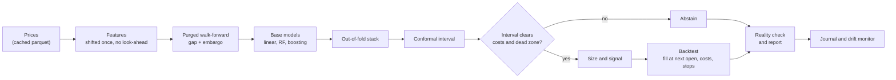

# stockpred

**Next-day return forecasting for NSE equities that tells you when it has no edge.**

[](#install)
[](#disclaimer)
<!-- Add once they exist:
[](https://github.com/<your-username>/stockpred/actions)
[](LICENSE)
-->

`stockpred` forecasts the **next-day log return** for NSE-listed equities. It forms a view
at the close of day `t`, the backtest fills at the open of day `t + 1`, every fill pays a
realistic Indian cost model, and the report is allowed to say "no trade" or "no edge" when
that is the honest answer.

Daily equity returns are close to noise. The goal here is a small, well-measured edge with
honest uncertainty, not a high R². A backtest that returns nothing is a valid result, not
a bug.

> **Research software.** Not investment advice. It places no orders. See the
> [disclaimer](#disclaimer).

## Contents

- [Quickstart](#quickstart)
- [How it works](#how-it-works)
- [What is different](#what-is-different)
- [Install](#install)
- [Usage](#usage)
- [How to read the output](#how-to-read-the-output)
- [Configuration](#configuration)
- [Repository layout](#repository-layout)
- [Docker](#docker)
- [Development](#development)
- [Troubleshooting and FAQ](#troubleshooting-and-faq)
- [Limitations](#limitations)
- [References](#references)
- [Contributing](#contributing)
- [License](#license)
- [Disclaimer](#disclaimer)

## Quickstart

Requires Python 3.10 or newer.

```bash
git clone https://github.com/<your-username>/stockpred.git
cd stockpred
python -m venv .venv
source .venv/bin/activate          # Windows: .venv\Scripts\activate
pip install -e ".[data,app,dev]"

stockpred run                      # fetch, train, backtest, forecast, rank, read
```

On Windows you can skip the setup: `run.cmd` at the repository root creates the virtual
environment the first time and then runs everything.

```powershell
.\run.cmd                 # fetch, train, backtest, forecast, rank, read
.\run.cmd --app           # the same, then open the dashboard
.\run.cmd --tune          # the same, with a hyperparameter search (slow)
.\run.cmd --report        # the same, plus an HTML tear sheet per symbol
.\run.cmd --help          # every other flag
```

`stockpred run` skips tuning by default because the hyperparameter search is the slow
part. Pass `--tune` when you want it.

The forecast for one symbol looks like this (the format only; every value is a
placeholder, not a result):

```text
TCS.NS  next-session forecast
  expected log return : <value>     interval : [<low>, <high>]
  break-even move     : <value>     (round-trip cost plus slippage)
  decision            : NO TRADE    (interval straddles zero)
  regime              : <calm | normal | stressed>
  reality check       : permutation p = <value> | deflated Sharpe = <value>
```

## How it works



1. **Data.** Price history is downloaded once and cached as parquet with a freshness rule.
2. **Features.** Indicators are computed on unshifted data, then the frame is shifted once.
   Row `t` may use the close at `t`; it never sees `t + 1`.
3. **Validation.** Expanding-window folds with a gap and an embargo, so no training label
   window reaches into the test block.
4. **Models.** Linear and tree-based base models, combined by a meta-model trained only on
   out-of-fold predictions.
5. **Uncertainty.** Split-conformal intervals give the forecast a stated coverage.
6. **Decision.** If the interval straddles zero, or the expected move is smaller than the
   cost of trading it, the model abstains.
7. **Backtest.** Signals fill at the next open, pay Indian costs and slippage, and are
   checked against the day's High and Low for stops and targets.
8. **Reality check.** Permutation test, deflated Sharpe ratio and a comparison against
   buy-and-hold and naive baselines decide whether any of it beats chance.
9. **Record.** Forecasts go into a paper-trading journal before the outcome exists, and a
   drift monitor watches for decay.

## What is different

Most stock-prediction projects show a high R² and a rising equity curve. The differentiator
here is credibility. These choices make the results hard to fake:

| Choice | What it means in the code |
| --- | --- |
| No look-ahead | Signal at the close of day `t`, fill at the next open. A feature row may use the close at `t` (the target is `t + 1`) but never `t + 1`. |
| Purged walk-forward CV | Expanding-window folds with a gap of at least the longest lookback **and** an embargo, so a training row's label window never reaches into the test block. |
| Out-of-fold stacking | The meta-model is trained only on base predictions from a model that never saw that row. |
| Conformal intervals | Split-conformal prediction gives a stated coverage with a finite-sample correction, instead of `prediction ± 1.96 · std`. |
| Abstain by design | No trade when the interval straddles zero or the expected move is inside the dead zone. The journal reports how often it abstained and how it did when it acted. |
| Real Indian cost model | Brokerage, STT (delivery vs intraday), exchange transaction charges, SEBI fees, stamp duty, GST, and the DP charge on delivery sells, plus slippage that grows with order size relative to average daily volume. |
| Overfitting controls | Deflated Sharpe ratio, probability of backtest overfitting, permutation test and a shuffled-label sanity check. |
| Regime tags | Each day is tagged calm / normal / stressed from a rolling volatility percentile. An HMM is used when `hmmlearn` is installed; it is not required. |
| Drift monitor | Rolling information coefficient, population stability index (PSI) per feature, and a calibration table. |
| Paper-trading journal | Forecasts are logged before the outcome exists and settled afterwards, so the out-of-sample record cannot be quietly edited. |
| Grounded analyst | "Why did the model turn bearish on TCS?" is answered from the stored forecast, attributions, headlines, journal and run ledger, with a `[S1]`-style citation on each claim. A language model is optional; its reply is discarded if it cites nothing. |
| Leakage canary | A test injects a feature containing tomorrow's return; the pipeline must detect it and fail loudly. This runs in CI. |

## Install

Requires Python 3.10 or newer. From the repository root:

```bash
python -m venv .venv
source .venv/bin/activate          # Windows: .venv\Scripts\activate
pip install -e ".[data,app,dev]"
```

| Extra | Adds |
| --- | --- |
| `data` | `yfinance` for price history |
| `app` | Streamlit and Plotly for the dashboard |
| `dev` | Test and lint tooling |

Heavy optional libraries are **never required**. The code degrades gracefully and logs
when one is missing:

| Library | If it is missing |
| --- | --- |
| `xgboost`, `lightgbm` | Falls back to scikit-learn estimators |
| `optuna` | Tuning is skipped; defaults are used |
| `shap` | Falls back to a model-agnostic importance view |
| `hmmlearn` | Regimes use the volatility-percentile tag |
| `transformers` | Headline sentiment is skipped |
| `weasyprint` | The HTML tear sheet is still written; only the PDF is skipped |
| `pandera` | Optional frame-schema checks are skipped |

## Usage

Every command takes `--config` and `--costs` to point at different YAML files, and
`-v` / `--verbose` for debug logging. Run `stockpred <command> --help` for the full list of
options.

| Command | What it does |
| --- | --- |
| `stockpred run` | The whole pipeline: fetch, train, backtest, forecast, rank, read |
| `stockpred fetch` | Download price history into the parquet cache |
| `stockpred train --symbols TCS.NS` | Fit the ensemble for a symbol |
| `stockpred backtest` | Walk-forward backtest with costs, stops and the reality check |
| `stockpred predict --symbols TCS.NS` | Forecast the next session |
| `stockpred screen` | Rank a universe by expected risk-adjusted return |
| `stockpred report TCS.NS --pdf` | Write a tear sheet (the PDF is attempted when `--pdf` is given) |
| `stockpred ask "why did the model turn bearish?" --symbol TCS.NS` | Answer from the stored records, with citations |
| `stockpred app` | Launch the Streamlit dashboard |

Symbols use Yahoo Finance tickers: `.NS` for NSE (for example `RELIANCE.NS`) and `.BO` for
BSE.

## How to read the output

- **A zero-trade backtest is a legitimate result.** It means no session's expected move
  cleared the round-trip cost of trading that symbol. That is the tool doing its job.
- **A small positive information coefficient is normal.** IC is a rank correlation between
  forecast and outcome. On daily equity data, a few hundredths is ordinary and near-zero is
  common. It is not a return.
- **Look at the reality check before the equity curve.** The permutation p-value, the
  deflated Sharpe ratio and the comparison against buy-and-hold say whether any of it beats
  chance. The report states "no statistically significant edge" when that is the case.
- **Costs are shown next to every forecast.** The break-even move is the minimum move a
  signal needs just to pay for trading it. A forecast smaller than that is noise.

## Configuration

Defaults live in `configs/default.yaml` (symbols, risk limits, model grids) and
`configs/costs_india.yaml` (brokerage, STT, stamp duty, GST, with an as-of date). Both are
loaded into one validated settings object, and environment variables override them. The
environment prefix is `STOCKPRED_`, for example `STOCKPRED_ARTIFACTS_DIR`.

Check the as-of date in `costs_india.yaml` before trusting a backtest. Charges change, and
at small expected moves the cost model decides the result.

Copy `.env.example` to `.env` to set optional keys. Nothing there is needed to run the
backtest; the keys only enable optional integrations.

```bash
cp .env.example .env
```

## Repository layout

```text
stockpred/
├── pyproject.toml
├── README.md
├── run.cmd                     # Windows one-command runner
├── .env.example
├── Dockerfile
├── docker-compose.yml
├── configs/
│   ├── default.yaml            # symbols, risk limits, model grids
│   └── costs_india.yaml        # brokerage, STT, stamp duty, GST (with as-of date)
├── src/stockpred/
│   ├── config.py               # pydantic settings loader
│   ├── logging_setup.py
│   ├── schemas.py              # Forecast, Trade, BacktestResult, pandera schemas
│   ├── data/
│   │   ├── loaders.py          # yfinance + fallback sources
│   │   ├── cache.py            # parquet cache with freshness rules
│   │   ├── validation.py       # quality checks, split/dividend handling
│   │   ├── calendar.py         # NSE trading days and holidays
│   │   ├── market_context.py   # Nifty, VIX, USD/INR, sector indices
│   │   └── events.py           # results dates, corporate actions, flows
│   ├── features/
│   │   ├── indicators.py       # pure functions, no shifting inside
│   │   ├── builder.py          # assemble feature frame, shift once, X_live
│   │   ├── cross_section.py    # peer and sector ranks, relative strength
│   │   ├── selection.py        # pruning, correlation clusters
│   │   └── leakage_checks.py   # canary and future-row-change tests
│   ├── targets.py              # log return, direction, triple-barrier labels
│   ├── validation/
│   │   ├── splits.py           # purged walk-forward with embargo
│   │   ├── metrics.py          # RMSE, IC, directional accuracy, OOS R²
│   │   └── stats_tests.py      # permutation, shuffled-label, deflated Sharpe
│   ├── models/
│   │   ├── baselines.py        # naive, drift, SMA rule
│   │   ├── registry.py         # model factory from config
│   │   ├── tuning.py           # Optuna studies
│   │   ├── stacking.py         # out-of-fold stacking
│   │   ├── uncertainty.py      # conformal and quantile intervals
│   │   ├── regimes.py          # HMM or volatility regimes
│   │   └── persistence.py      # save/load full bundle with versions
│   ├── backtest/
│   │   ├── engine.py           # event loop, fills at next open, stops on High/Low
│   │   ├── costs.py            # Indian cost model + slippage
│   │   ├── sizing.py           # vol targeting, capped Kelly
│   │   ├── risk.py             # Sharpe, Sortino, drawdown, exposure
│   │   ├── portfolio.py        # multi-stock, sector caps
│   │   └── robustness.py       # Monte Carlo, sensitivity, stress tests
│   ├── explain/
│   │   ├── shap_utils.py
│   │   ├── narratives.py       # plain-language signal explanations
│   │   └── analyst.py          # grounded Q&A with citations to the records
│   ├── monitoring/
│   │   ├── drift.py            # rolling IC, PSI, calibration
│   │   └── journal.py          # paper-trading log
│   ├── sentiment/
│   │   └── news.py             # headline sentiment, timestamps
│   ├── pipelines/
│   │   ├── train.py
│   │   ├── predict.py
│   │   ├── backtest.py
│   │   └── screen.py           # universe ranking
│   ├── reporting/
│   │   ├── tearsheet.py        # HTML/PDF report
│   │   └── alerts.py           # Telegram / email
│   ├── viz/plots.py            # plotly figures, shared by UI and reports
│   └── cli.py                  # typer entry point
├── app/
│   ├── Home.py                 # Streamlit entry
│   └── pages/
│       ├── 1_Data.py
│       ├── 2_Models.py
│       ├── 3_Backtest.py
│       ├── 4_Signals.py
│       ├── 5_Screener.py
│       └── 6_Diagnostics.py    # Reality Check, drift, regimes
├── tests/
│   ├── test_indicators.py
│   ├── test_leakage.py
│   ├── test_costs.py
│   ├── test_backtest_accounting.py
│   └── test_splits.py
├── notebooks/                  # exploration only, never imported
└── artifacts/                  # cache, models, reports (git-ignored)
```

Each folder owns one job and imports only from the folders above it in the tree, so the
data layer never depends on the UI.

## Docker

Build the image and run the Streamlit app:

```bash
docker build -t stockpred .
docker run --rm -p 8501:8501 -v "$PWD/artifacts:/app/artifacts" stockpred
```

Or with Compose:

```bash
docker compose up
```

Then open <http://localhost:8501>. Mount `artifacts/` so the parquet cache, saved model
bundles and generated reports persist between runs. Without the mount they are lost when
the container exits.

## Development

```bash
pytest
ruff check .
black .
```

The test suite covers indicator values, the leakage canary, the cost model, backtest
accounting (cash plus positions equals equity), the split logic and the persistence round
trip.

If you add a feature, add it to `features/indicators.py` as a pure function with no
shifting inside, and let `features/builder.py` do the single shift. The leakage canary
should keep passing without changes.

## Troubleshooting and FAQ

**The backtest made zero trades.**
That can be correct. No expected move cleared the round-trip cost for that symbol, or the
interval straddled zero every session. Check the break-even move in the forecast output
and the abstain rate in the journal.

**The information coefficient is close to zero.**
That is common for daily equity data. See [How to read the output](#how-to-read-the-output).

**A symbol returns no data.**
Use the Yahoo Finance form with the exchange suffix: `RELIANCE.NS` or `RELIANCE.BO`.
Recent listings may not have enough history for the longest lookback windows.

**Results look stale or wrong after I changed the config.**
Delete the cached files under `artifacts/` and rerun. The cache has a freshness rule, but
a changed config does not always trigger a refetch.

**Can I use non-Indian stocks?**
The pipeline works on any ticker the data source returns, but the default cost model is
Indian. Supply your own file with `--costs` or the backtest will use the wrong charges.

**A library is missing and something was skipped.**
That is the graceful fallback. Check the log (`-v` for detail) and see the
[table of optional libraries](#install).

**Why do I get a different result from the dashboard and the CLI?**
Make sure both use the same `--config`, `--costs` and `artifacts/` directory.

## Limitations

- **Daily bars only.** There is no intraday modelling.
- **Data quality is the data source's.** The default source is Yahoo Finance. Gaps,
  late corrections and thin trading in small caps can distort features and fills.
- **Cost rates drift.** Brokerage, STT and other charges change; the as-of date in the
  cost file tells you how old the assumptions are.
- **Slippage is a model.** It scales with order size against average daily volume, which
  is an approximation, not a replay of the order book.
- **A backtest is not a forecast of returns.** Costs, regime changes and the number of
  configurations you try all affect how far the result generalises.

## References

The methods follow standard work in the field:

- Marcos López de Prado, *Advances in Financial Machine Learning* (2018): purged
  cross-validation, embargo, triple-barrier labels and meta-labeling.
- David H. Bailey and Marcos López de Prado, "The Deflated Sharpe Ratio" (2014).
- David H. Bailey, Jonathan Borwein, Marcos López de Prado and Qiji Jim Zhu, "The
  Probability of Backtest Overfitting" (2017).
- Jing Lei, Max G'Sell, Alessandro Rinaldo, Ryan J. Tibshirani and Larry Wasserman,
  "Distribution-Free Predictive Inference for Regression" (2018): split-conformal
  prediction.

## Contributing

Issues and pull requests are welcome. Before opening one, run `pytest`, `ruff check .` and
`black .`. Changes that touch features or the backtest should keep the leakage canary and
the accounting test passing, and should not introduce any step that reads data from after
the signal time.

## License

<!-- Replace with your license, and add a LICENSE file. -->
Released under the `<LICENSE>` license. See [LICENSE](LICENSE).

## Disclaimer

This is research software. It is not investment advice, and it places no orders. It
separates research output from any broker integration on purpose: the model's only output
is a forecast, an interval and a note about costs, and any trading decision is yours. The
results of any backtest depend on the cost assumptions and data you feed it. Past backtest
performance does not predict future results.
